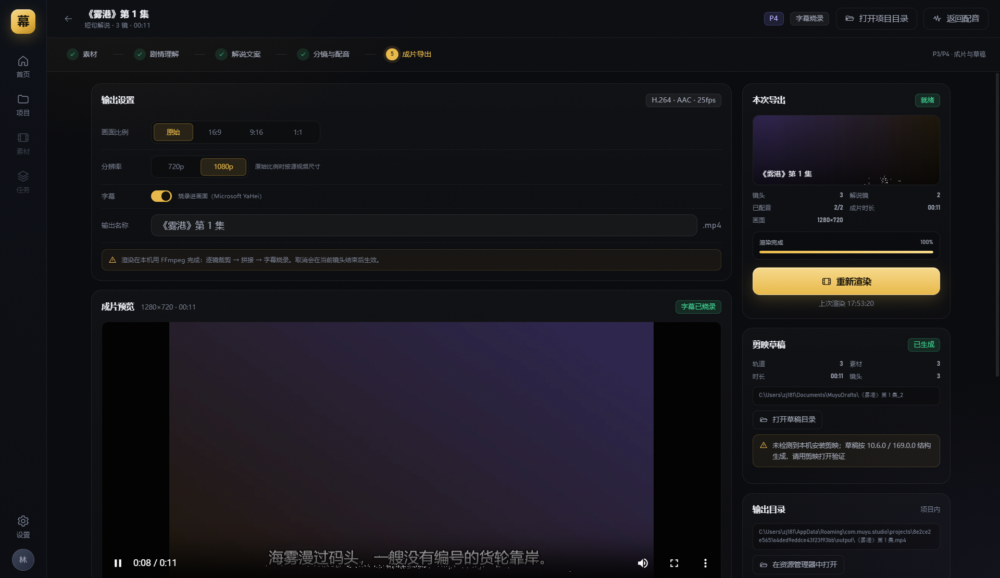

# 幕语 · 项目导航

AI 影视解说一键生成桌面软件 · **Tauri 2 + Rust + Vue 3 + Naive UI**

## 现在能跑什么

```powershell
cd muyu
pnpm install
pnpm tauri dev
```

当前是 **P4（完成，未签名）**：项目库 → 视频导入 → SRT → 剧情理解 → 逐句文案 → 分镜 → Edge TTS 配音 + 时间轴 → **成片 MP4 / SRT / items** → **剪映五轨草稿 + BGM 混音/闪避** → **批量队列**。
剪映草稿已生成五轨（视频/原声/配音/字幕/BGM）并复制素材；**本机未安装剪映，尚未做剪映内打开验证**。成片支持 BGM、闪避、淡入淡出、硬件编码探测/回退；批量队列、系统托盘/单实例与 NSIS 安装包（未签名）已完成。



## 目录

| 路径 | 内容 |
|---|---|
| [`muyu/`](muyu/) | 可运行工程（Rust + Vue） |
| [`docs/01-narratoai-feature-map.md`](docs/01-narratoai-feature-map.md) | NarratoAI 功能与流水线拆解、1:1 清单 |
| [`docs/02-product-design.md`](docs/02-product-design.md) | 信息架构、页面、设计系统、短句解说规范 |
| [`docs/03-build-plan.md`](docs/03-build-plan.md) | 分阶段实施计划与风险 |
| [`docs/04-p0-report.md`](docs/04-p0-report.md) | P0 交付与验证记录 |
| [`docs/05-p1-report.md`](docs/05-p1-report.md) | P1 交付与验证记录 |
| [`docs/06-p2-report.md`](docs/06-p2-report.md) | P2 交付与验证记录 |
| [`docs/07-p3-report.md`](docs/07-p3-report.md) | P3 交付与验证记录 |
| [`docs/08-p4-report.md`](docs/08-p4-report.md) | P4 剪映草稿交付与验证记录 |
| [`docs/09-p4-bgm-report.md`](docs/09-p4-bgm-report.md) | P4 BGM 混音与草稿音轨 |
| [`docs/10-p4-audio-report.md`](docs/10-p4-audio-report.md) | P4 闪避与淡入淡出 |
| [`docs/11-p4-encoder-report.md`](docs/11-p4-encoder-report.md) | P4 硬件编码探测与回退 |
| [`docs/12-p4-batch-report.md`](docs/12-p4-batch-report.md) | P4 原声轨、可调闪避、批量队列 |
| [`docs/13-architecture.md`](docs/13-architecture.md) | 项目结构与发布说明 |
| [`docs/14-release-hardening.md`](docs/14-release-hardening.md) | 日志/自启/签名/更新 |
| [`docs/15-updater.md`](docs/15-updater.md) | GitHub Release 自动更新 |
| [`muyu/release/`](muyu/release/) | NSIS 安装包 + portable exe |
| [`design/`](design/) | 高保真界面稿 + 真实桌面端截图 |
| `_research/NarratoAI/` | 参考项目源码（MIT，只读研究用） |

## 截图

| 阶段 | 截图 |
|---|---|
| 首页 | `design/screens/p0-home.png` |
| 素材工作台 | `design/screens/p0-studio.png` |
| 剧情理解 | `design/screens/p1-plot.png` |
| 逐句文案 | `design/screens/p1-copy.png` |
| 分镜脚本 | `design/screens/p1-items.png` |
| 模型设置 | `design/screens/p1-settings.png` |
| 配音与时间轴 | `design/screens/p2-voice.png` |
| 成片导出 | `design/screens/p3-export.png` |
| 成片与剪映草稿 | `design/screens/p4-jianying.png` |
| BGM 混音 | `design/screens/p4-bgm.png` |
| BGM 闪避 | `design/screens/p4-ducking.png` |
| 编码器回退 | `design/screens/p4-encoder.png` |
| 批量队列 | `design/screens/p4-batch.png` |
| 设计稿 | `design/screens/home.png` / `script.png` / `timeline.png` / `export.png` |

## 路线

- **P0（完成）** 素材与项目库
- **P1（完成）** 模型接入 → 剧情理解 → 逐句文案 → items 脚本
- **P2（完成）** Edge TTS / SAPI、逐句配音、时长回写、四轨时间轴
- **P3（完成）** 按配音重剪、字幕烧录、成片 MP4、SRT / items 导出
- **P4（完成，未签名）** 剪映五轨草稿、BGM 混音/闪避/淡入淡出、硬件编码探测、批量队列、NSIS 安装包已完成；链接下载、本地克隆 TTS、ASR 仍待做

## 说明

NarratoAI 为 MIT 协议。本项目参考其公开流程与字段语义（`OST`、`items`、音画对齐、剪映明文草稿 schema），界面与 Rust/Vue 代码为独立实现，未复制其源码与素材。
